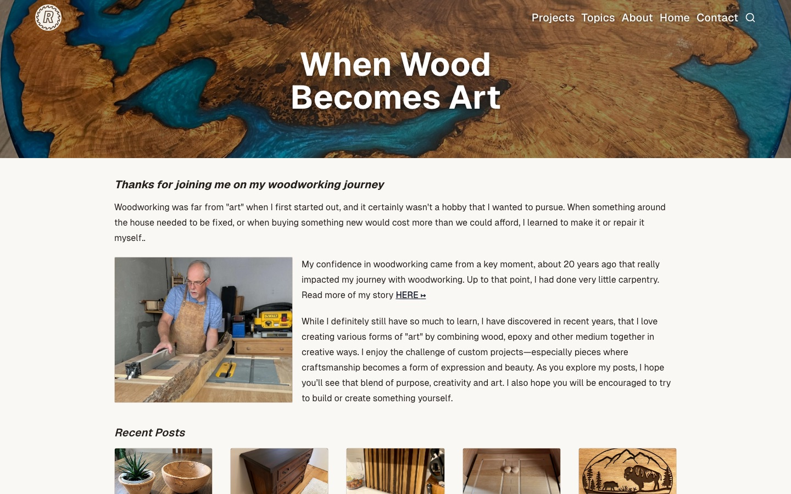
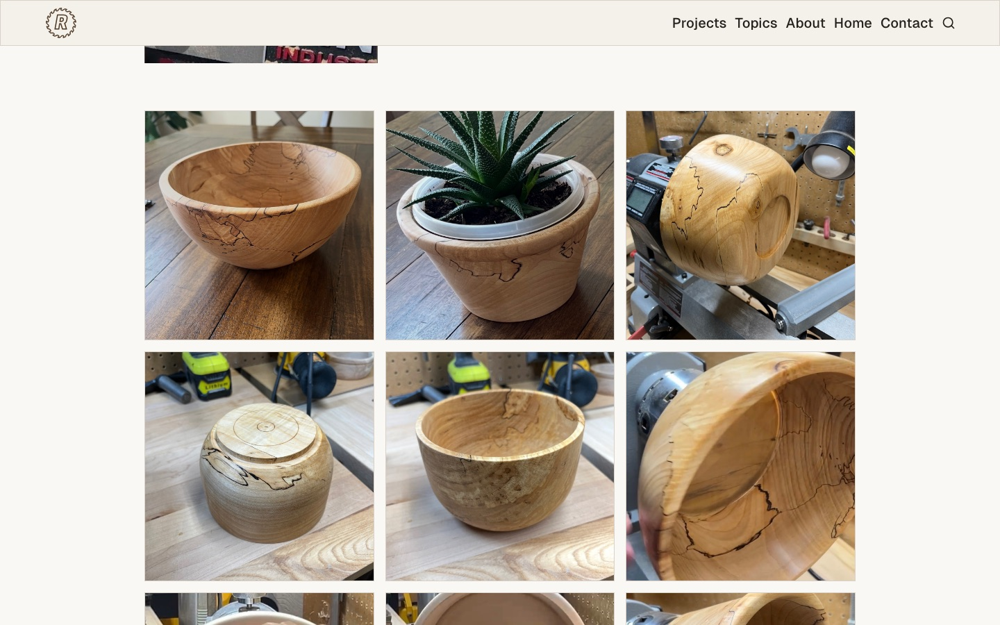
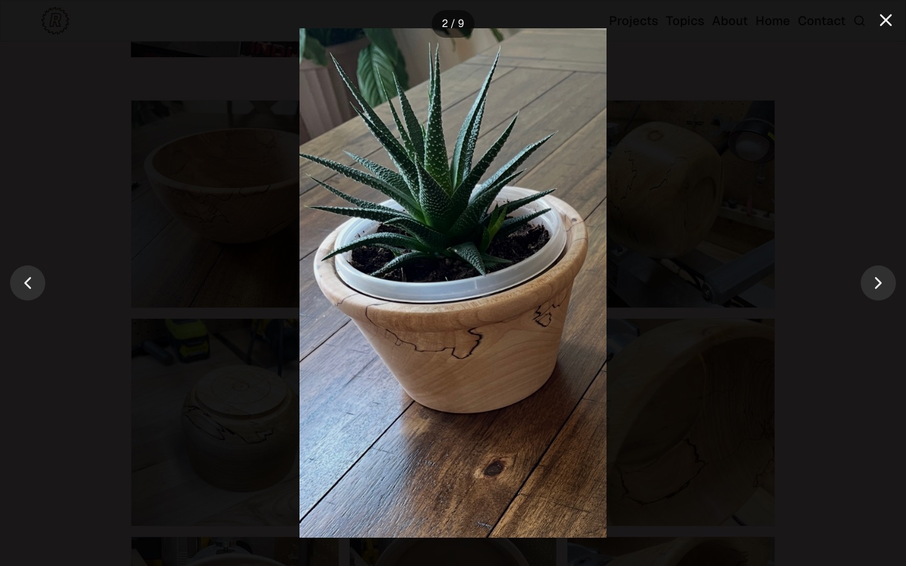

# Woodworking Blog

A woodworking blog I built for my dad. He writes up his projects there: live-edge tables, turned bowls, epoxy river pieces, restored furniture. He runs the site himself through an admin panel, so he can publish a post with photo galleries and shop videos without touching code.

**Live site:** https://robert-blog.vercel.app/home-page



## Stack

- **[Payload CMS 3](https://payloadcms.com)** for content and the admin panel, running inside the Next.js app
- **Next.js 15** (App Router, React 19, server components) and **TypeScript**
- **Tailwind CSS** with shadcn/ui components
- **Vercel Postgres** for the database, through Payload's Postgres adapter and its migrations
- **Vercel Blob** for uploaded images and video
- Hosted on **Vercel**, with a daily Vercel cron that runs Payload's job queue

The project started from Payload's official website template, which provides pages, posts, categories, search, SEO, redirects, drafts and live preview. Everything below was built on top of that for this site.

## What I built

### Image galleries with a lightbox



The `ImageGallery` block ([`src/blocks/ImageGallery`](src/blocks/ImageGallery)) shows a set of photos as a 2–4 column grid or as a carousel, with a choice of aspect ratio, maximum size and optional captions. Clicking a photo opens a full-screen lightbox with an image counter, previous and next buttons, and keyboard navigation: ← and → move between photos and Esc closes it. Single images (`ImageBlock`) and images inside the `Layout` block open the same kind of full-screen view.



### YouTube embeds

My dad posts many of his projects as YouTube Shorts. The `YouTubeEmbed` block ([`src/blocks/YouTubeEmbed`](src/blocks/YouTubeEmbed)) takes a video ID and supports widescreen, standard, square and vertical (9:16, 4:5) aspect ratios. It also has options for autoplay, loop, mute, controls, related videos, and start and end times. The `Layout` block places a video, an image or rich text side by side in columns, so a Short can sit beside the write-up.

### A media manager that checks usage before deleting

Payload's built-in media list doesn't show where an image is used, and Vercel Blob can be left holding files that no media record points to anymore. I added a **Blob Storage** view to the admin panel ([`src/components/BlobStorageView`](src/components/BlobStorageView)) that:

- lists every media item with its size, and whether it's in use and on which pages or posts. [`checkMediaUsage`](src/utilities/checkMediaUsage.ts) looks at hero images, SEO images and every block nested in the rich-text content;
- warns before you delete images that are still in use, then deletes each one from both Payload and Blob storage;
- finds orphaned blobs (files with no matching media record) and removes them in one click.

Its API routes live under [`src/app/(payload)/api`](src/app/(payload)/api) and only answer to a logged-in admin.

### Smaller additions

- A separate hero image for mobile screens, for wide banner photos that crop badly on a phone
- Gallery images that can float inline beside text, plus a `Break` block that clears the float so the next section starts below them
- Post dates and category chips on post cards, and a more compact related-posts row

## Running it locally

You'll need Node 22 and a Postgres database. Media uploads go to Vercel Blob, so you'll need a Blob read/write token to upload images.

```bash
git clone https://github.com/cjrussell23/woodworking-blog.git
cd woodworking-blog
cp .env.example .env    # then fill in the values
npm install
npm run dev
```

Open http://localhost:3000/admin and create the first admin user. In development, Payload syncs the database schema automatically. In production, `npm run ci` runs the migrations in [`src/migrations`](src/migrations) and then builds the site.

Other useful scripts:

| Script | What it does |
| --- | --- |
| `npm run generate:types` | Regenerates `src/payload-types.ts` after a schema change |
| `npm run generate:importmap` | Regenerates the admin import map after adding admin components |
| `npm run migrate:create` | Creates a migration from schema changes |
| `npm run lint` | Runs ESLint |

## License

MIT. See [LICENSE](LICENSE).
